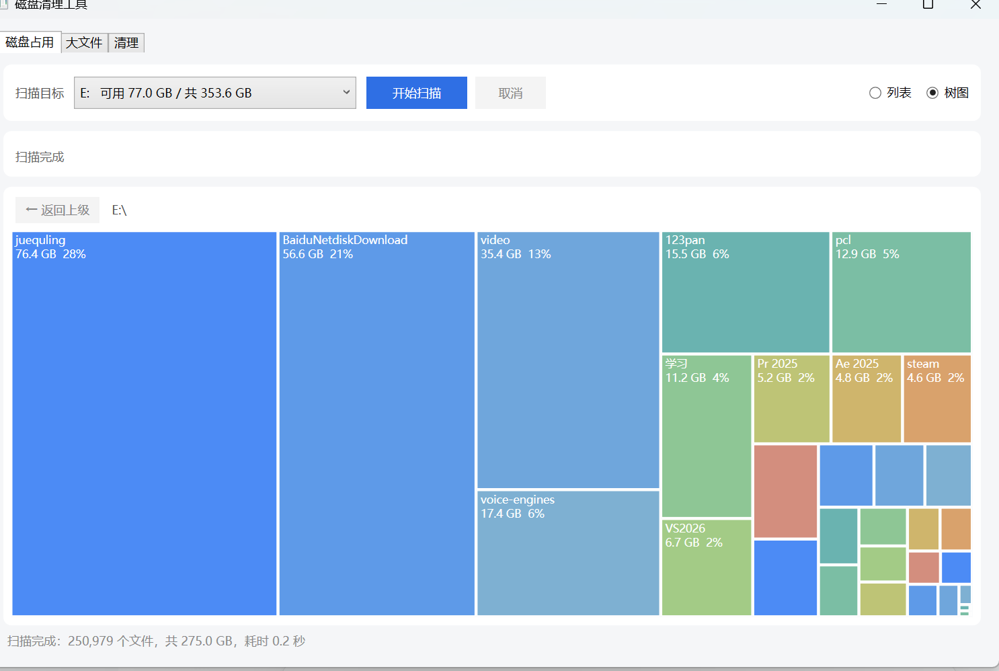
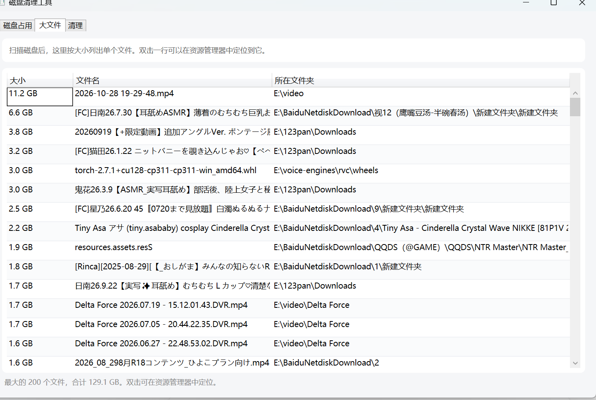
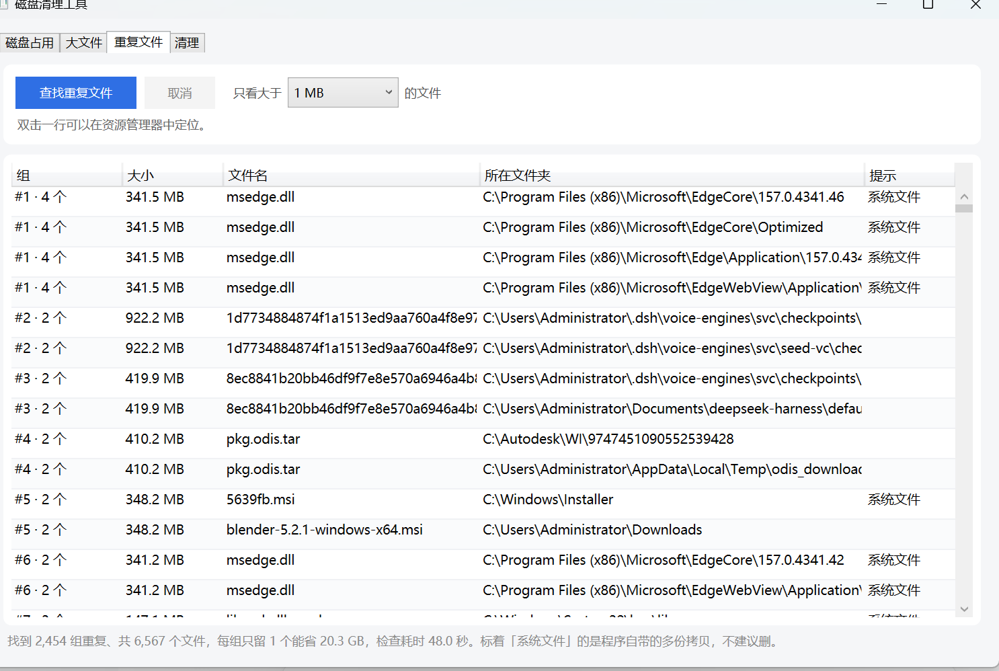
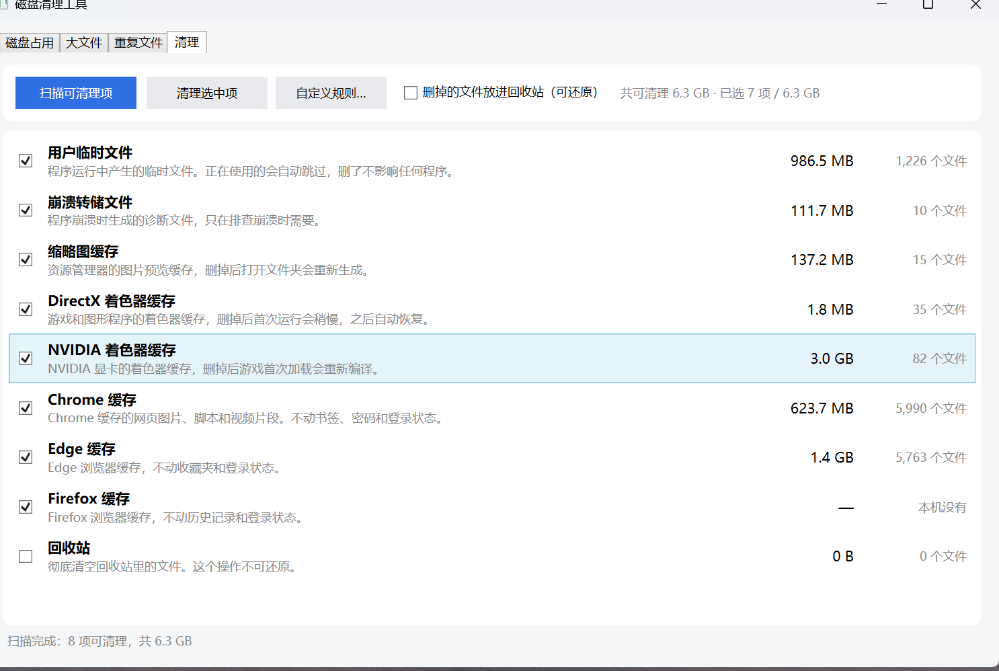
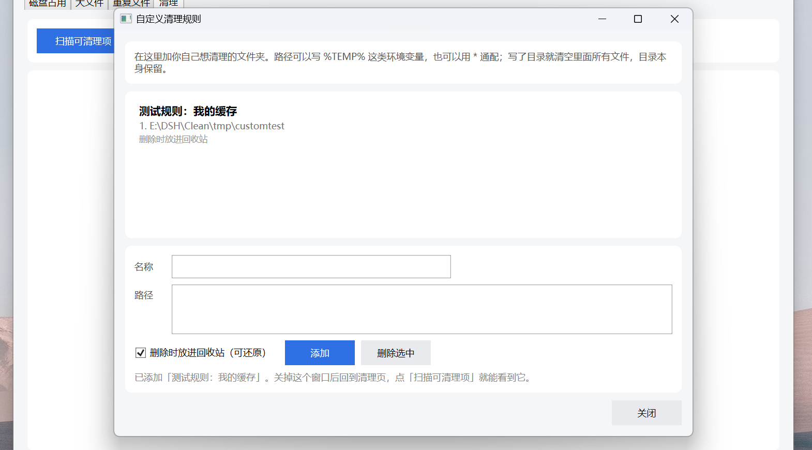

# DiskCleaner

一个轻量的 Windows 磁盘清理工具。.NET 8 + WPF，单窗口、无外部依赖、不联网。

## 功能

### 📊 磁盘占用

扫描整个硬盘，按文件夹列出占用大小、文件数和占比。

- 列表 / 树图两种视图，树图里方块面积 = 实际占用
- 点击方块能下钻进子文件夹，左上角「返回上级」
- 全盘 25 万个文件、275 GB 大约 1–2 秒扫完



### 📁 大文件

列出全盘最大的 200 个文件，双击直接在资源管理器里定位到它。



### 🔍 重复文件

三阶段查找：先按大小分组，再比对每个文件的头 8KB，最后用完整 SHA-256 确认。只列出内容真正一模一样的文件。

- 可设置最小文件大小：1MB / 10MB / 100MB
- 自动标出 `Program Files`、`Windows` 下的重复项——那些基本是程序自带的多份拷贝，删了软件会坏，看得到但别动



### 🧹 清理

内置 9 条清理规则：用户临时文件、崩溃转储、缩略图缓存、DirectX / NVIDIA 着色器缓存、Chrome / Edge / Firefox 缓存、回收站。

- 先扫描出每一项能省多少空间，勾选确认后才动手
- 默认「删掉的文件放进回收站」，删错了能捡回来
- 正在被程序占用的文件会自动跳过
- 可以添加自己的规则：指定文件夹即可，支持 `%TEMP%` 这类环境变量和 `*` 通配符





## 安全性

清理工具最要紧的是不误删。

- **只删文件，不删目录**——目录结构保留，下次运行照常
- **默认走回收站**：调用 Windows `SHFileOperation` + `FOF_ALLOWUNDO`，不是硬删除
- **不碰系统文件**：内置规则只命中缓存和临时文件；重复文件里系统目录的项会单独标注
- **不联网**：没有任何网络请求，不收集、不上传任何数据
- **扫描全盘是只读的**：不写一个字节

## 系统要求

- Windows 10 / 11（x64）
- [.NET 8 桌面运行时](https://dotnet.microsoft.com/download/dotnet/8.0)（如果自己编译过就不用另装）

## 从源码构建

```bash
git clone https://github.com/Azicesea/DiskCleaner.git
cd DiskCleaner
dotnet build DiskCleaner.sln -c Release
```

需要 [.NET 8 SDK](https://dotnet.microsoft.com/download/dotnet/8.0)。产物在：

```
src/DiskCleaner.App/bin/Release/net8.0-windows/DiskCleaner.App.exe
```

## 项目结构

```
DiskCleaner.sln
├── src/
│   ├── DiskCleaner.Core/            核心逻辑，与界面无关
│   │   ├── Models/                  DirNode（目录树）、FileEntry
│   │   ├── Scan/                    DiskScanner（并行扫描）、TreemapLayout（squarified 树图）
│   │   ├── Clean/                   清理规则、扫描、执行、自定义规则存储
│   │   ├── Dup/                     DuplicateFinder（大小分组 + 预筛 + 哈希）
│   │   └── Interop/                 ShellInterop（回收站相关 Win32 API）
│   └── DiskCleaner.App/             WPF 界面
│       ├── MainWindow.xaml          四个页面：磁盘占用 / 大文件 / 重复文件 / 清理
│       └── CustomRulesWindow.xaml   自定义清理规则
└── tools/                           命令行验证工具与 UI 自动化测试脚本
```

## 已知限制

- 重复文件只比对 1MB 及以上的文件，小文件不参与
- 树图下钻只到文件夹层级，不展开单个文件（看单个大文件请去「大文件」页）
- 清理规则靠路径匹配，不理解文件内容；自定义规则的路径请自己确认
